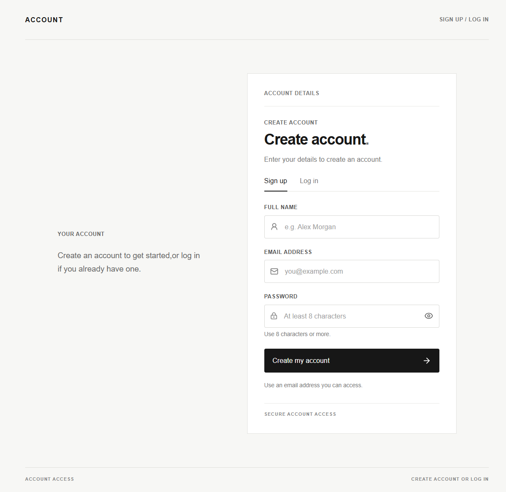
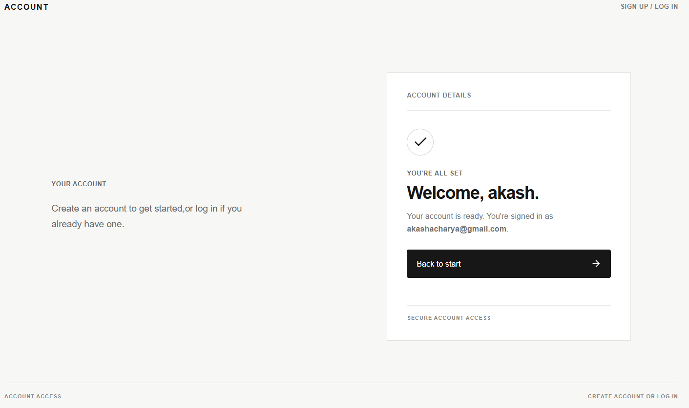
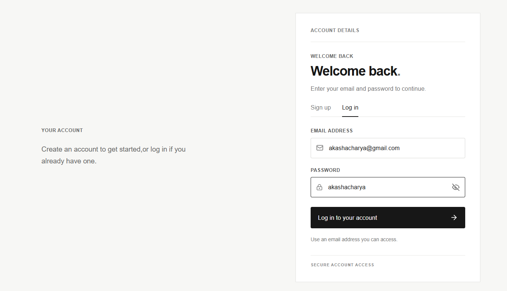
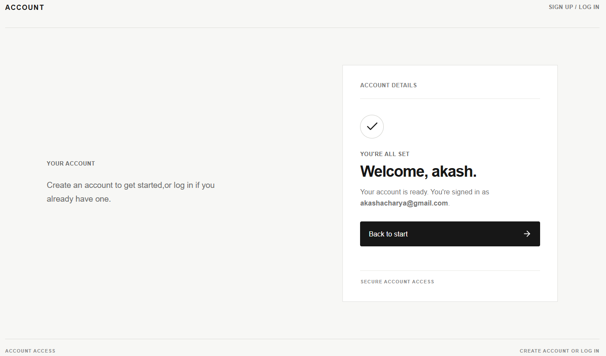
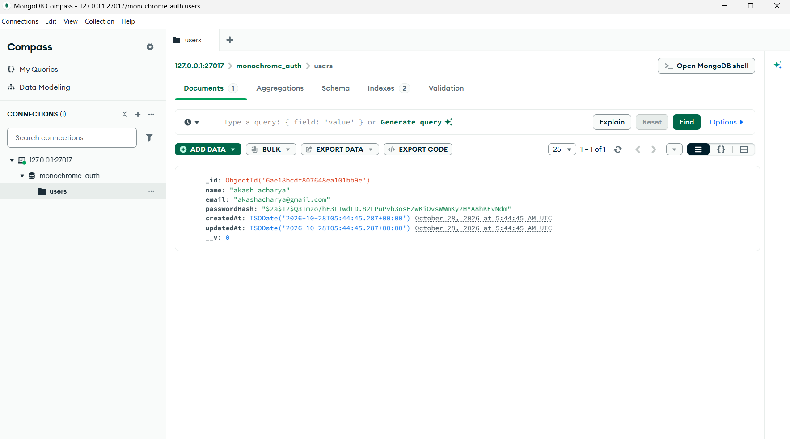

# Sign Up & Login

A beginner-friendly authentication web application built with **React,
Express.js, a REST API, and local MongoDB**. The interface uses a clean,
minimal black-and-white design.

## output

### 1. Sign-up page

Shows the registration form before details are submitted.



### 2. Successful registration

Shows the success screen after a new account is created.



### 3. Login page

Shows the login form for an existing account.



### 4. Successful login

Shows the success screen to the created account.



### 5. MongoDB Compass --- saved user

Shows the `monochrome_auth` database and `users` collection containing a
registered user document.



------------------------------------------------------------------------

## Features

-   Create an account with a name, email address, and password.
-   Log in with an existing email address and password.
-   Validate user input on the server.
-   Prevent registration with an email address that is already
    registered.
-   Hash passwords with `bcryptjs` before saving them.
-   Store account records in a local MongoDB database.
-   Use JSON REST API endpoints for registration, login, and API health
    checks.
-   Responsive, minimal black-and-white user interface.

## Technology stack

  -----------------------------------------------------------------------
  Technology                          Purpose
  ----------------------------------- -----------------------------------
  React + Vite                        Frontend and local development
                                      server

  CSS                                 Minimal, responsive styling

  Node.js                             JavaScript runtime

  Express.js                          Backend web server and REST API

  MongoDB Community Server            Local database

  Mongoose                            MongoDB object modelling

  bcryptjs                            Password hashing and password
                                      verification

  JSON Web Token (JWT)                Creates a token after successful
                                      registration or login
  -----------------------------------------------------------------------

## Project structure

``` text
signup-and-login/
├── client/
│   ├── src/
│   │   ├── App.jsx
│   │   ├── main.jsx
│   │   └── styles.css
│   ├── index.html
│   └── package.json
├── server/
│   ├── models/
│   │   └── User.js
│   ├── .env.example
│   ├── server.js
│   └── package.json
├── output/
│   ├── signup-page.png
│   ├── signup-success.png
│   ├── login-page.png
│   └── mongodb-users.png
└── README.md
```

## Requirements

Install these before running the project:

-   [Node.js LTS](https://nodejs.org/)
-   [MongoDB Community
    Server](https://www.mongodb.com/try/download/community)
-   [MongoDB Compass](https://www.mongodb.com/try/download/compass)
    (optional, for viewing saved records)
-   [Visual Studio Code](https://code.visualstudio.com/) (recommended)

Check that Node.js and npm are available in a terminal:

``` bash
node -v
npm -v
```

## Run locally on Windows

### 1. Start MongoDB

If MongoDB was installed as a Windows service, open **Services** from
the Start menu and make sure **MongoDB Server** is running.

The application uses this local MongoDB connection string by default:

``` text
mongodb://127.0.0.1:27017/monochrome_auth
```

### 2. Start the backend API

Open the extracted `monochrome-signup` project folder in VS Code. Open
**Terminal → New Terminal**, then run:

``` bash
cd server
npm install
npm run dev
```

Wait for output similar to:

``` text
Connected to local MongoDB: mongodb://127.0.0.1:27017/monochrome_auth
API listening at http://localhost:5000
```

Keep this terminal open.

### 3. Start the React frontend

Open a **second terminal** in VS Code and run:

``` bash
cd client
npm install
npm run dev
```

Open the local URL printed by Vite, usually:

``` text
http://localhost:5173
```

Keep both terminals open while using the application.

## Verify the database

1.  Open MongoDB Compass.
2.  Connect to `mongodb://127.0.0.1:27017`.
3.  Open the `monochrome_auth` database.
4.  Open the `users` collection.
5.  Refresh the collection after successfully registering an account.

MongoDB creates the database and collection when the first account is
saved. The stored password field is a **hash**, not the original
password.

## REST API endpoints

  Method   Endpoint               Description
  -------- ---------------------- -----------------------------------
  `POST`   `/api/auth/register`   Creates a new account
  `POST`   `/api/auth/login`      Checks the email and password
  `GET`    `/api/health`          Checks whether the API is running


## How the application works

1.  The user fills out the form in the React frontend.
2.  React sends the form data to the Express REST API.
3.  Express validates the data and checks whether the email is already
    registered.
4.  For registration, the server hashes the password and saves the new
    user in MongoDB.
5.  The API returns a response, and the frontend displays a success or
    error message.


